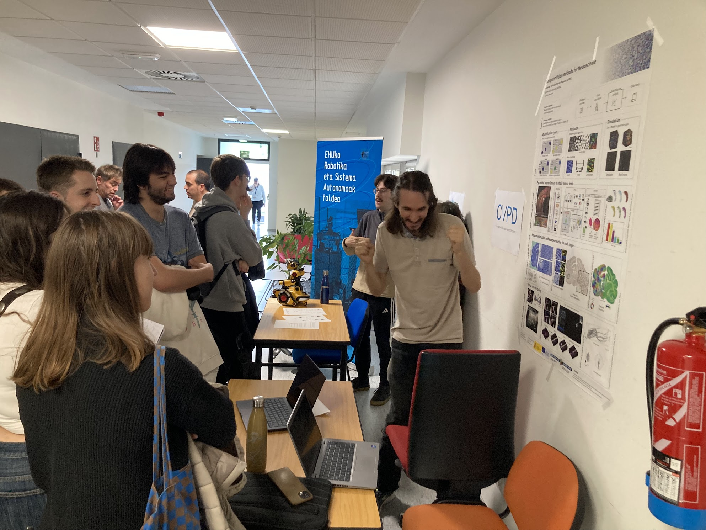

On **21 October 2026**, the **Computer Vision and Pattern Discovery (CVPD)** group participated in the networking fair for companies and research groups, an event aimed at connecting undergraduate and master's students with local companies and university research teams.

Throughout the morning, **Nagore Barrena, Clément Caporal and Ignacio Arganda-Carreras** represented our group, showcasing our research projects, methodologies and software tools. We had the opportunity to meet and talk with many students, introducing them to our research activities and the different opportunities to collaborate with us through **undergraduate final degree projects and master's theses**.

It was a great opportunity to share what we do, exchange ideas and connect with students interested in applying computer vision, machine learning and artificial intelligence to challenging research problems.

### 📸 A glimpse of the fair

Here are a couple of moments from our stand, with Clément Caporal presenting some of our research activities to interested students.

---

*Thanks to everyone who stopped by our stand! We look forward to welcoming new students to the CVPD team!*