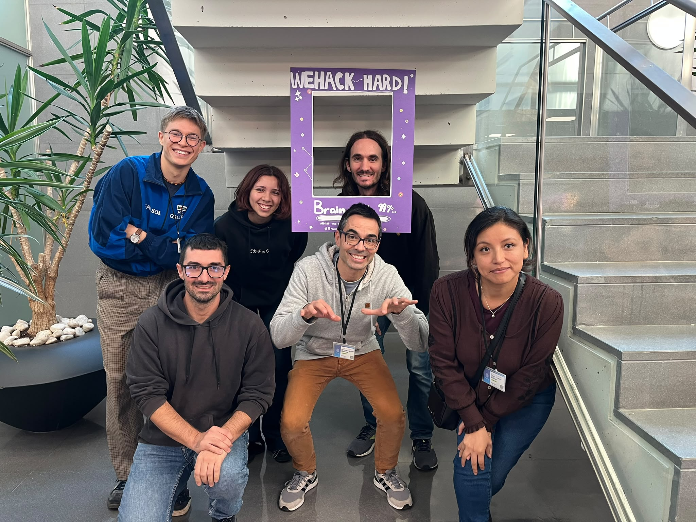
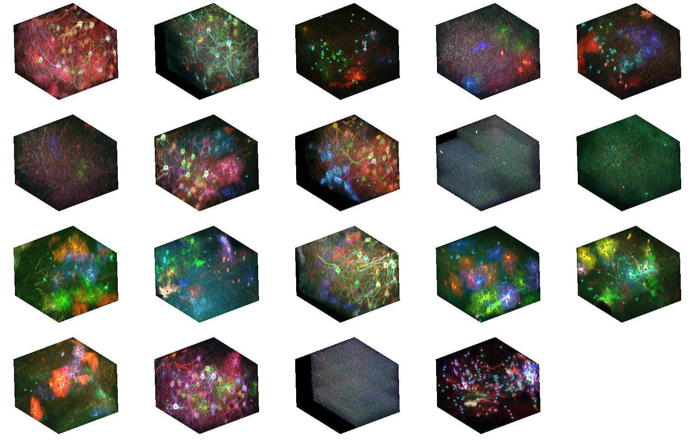

From **3 to 6 November 2026**, the **Computer Vision and Pattern Discovery (CVPD)** group participated in the [**Brainhack Donostia 2026**](https://brainhack-donostia.github.io/) event, a collaborative hackathon that brings together researchers, students, and enthusiasts from various disciplines to work on neuroscience-related projects.

**Brainbow** datasets enable researchers to distinguish individual cells and identify **lineage clusters**, providing valuable insights into brain development and cellular organization. Recent advances in microscopy, such as **ChroMS**, now make it possible to acquire **mesoscale images of entire brains**, opening new opportunities for **large-scale cellular analysis**.

We used a publicly available **brainbow image** of a mouse brain to propose a project focused on the **detection of cells centroids**. Our team was composed of  **Leonidas Ioannidis**, **Tania Orosco**, **Michal Ejankowski**, **Helen Fiorella Medina**, **Clément Caporal**, and **Ignacio Arganda-Carreras**.

### ~~(Ready, Set, Go!)~~ Brain - Bow - Hack !

The motivated team worked on the project using various tools such as:
- **napari** for visualization and annotation of the brainbow image along with the napari plugin **napari-point-proofreading** for the annotation of the cells centroids.
- **BiaPy** to train from scratch a deep learning model to detect the cells centroids, along with it's new **Fiji plugin**.
- **Python** for data processing and analysis.
- **Patience** and **food** to overcome the challenges.

In total exactly 1002 cells were annotated, with classes such as **Astrocytes** and **Pyramidal Neurons**.

All the annotated patch are available in a [Zenodo repository](https://zenodo.org/records/24339994) for further analysis and research. Do not hesitate to use them for your own research and to cite the original source of the data!

You want to continue to brainhack: open an issue in our [GitHub repository](https://github.com/CVPD/brainhack-donostia-2026)

---

*Thanks to the organizers and participants of the Brainhack Donostia 2026 event!*

#### Data license

- source: https://idr.openmicroscopy.org/study/idr0048/
- Authors: Multicolor multiscale brain imaging with chromatic multiphoton serial microscopy, Abdeladim L, Matho KS, Clavreul S, Mahou P, Sintes J-M, Solinas X, Arganda-Carreras I, Turney SG, Lichtman JW, Chessel A, Bemelmans A-P, Loulier K, Supatto W, Livet J, Beaurepaire E
- License / access: CC BY-NC 4.0